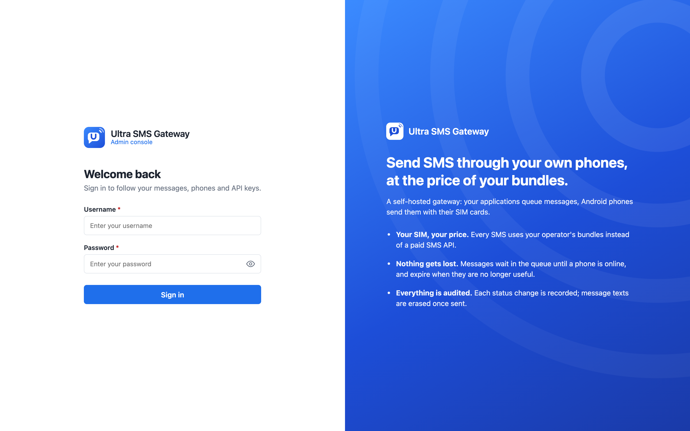
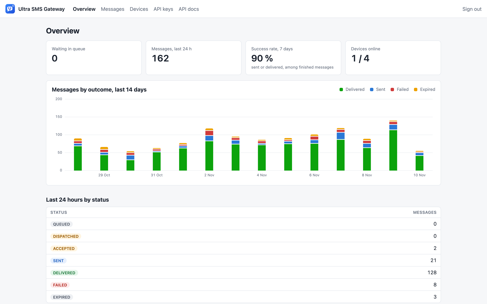
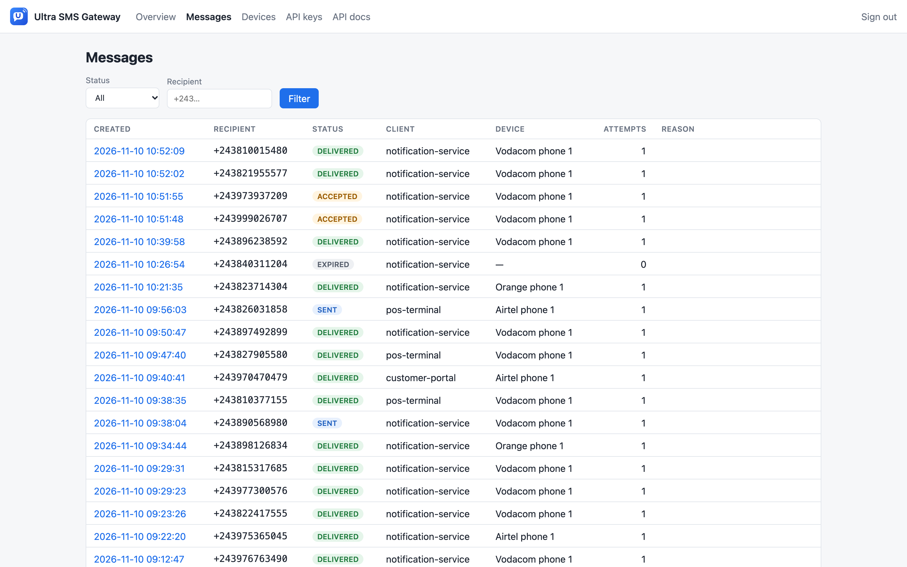
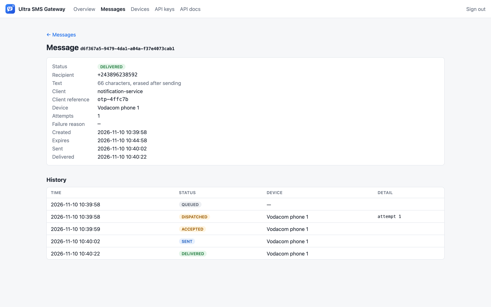
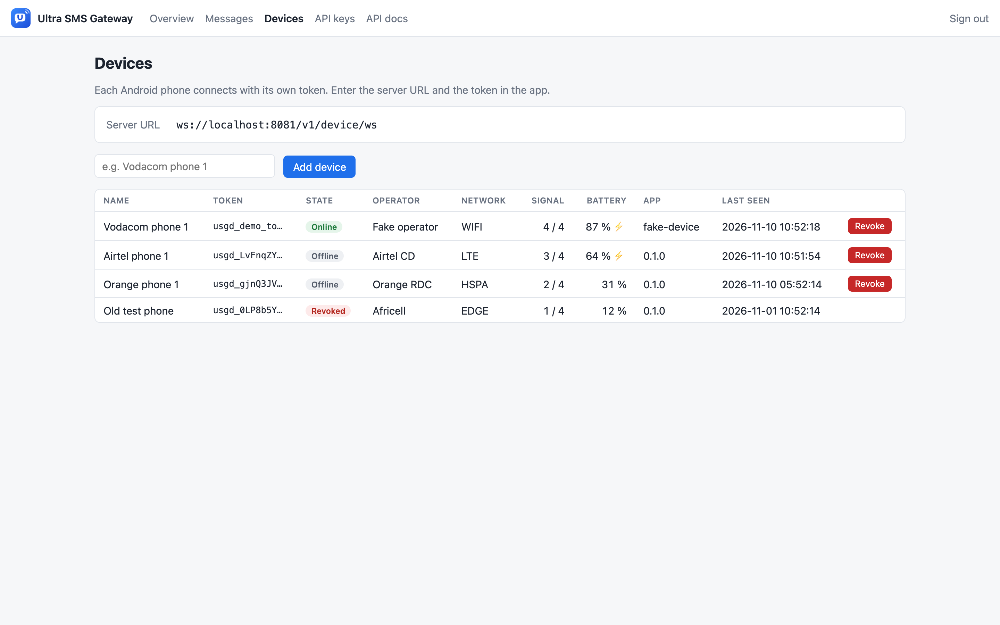
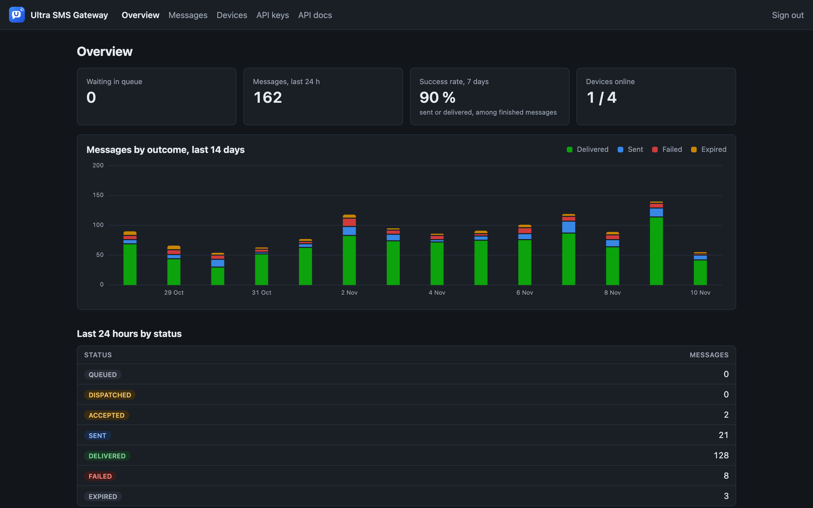

# Ultra SMS Gateway

[](LICENSE)
[](https://hub.docker.com/r/philipperusare/ultra-sms-gateway)

Send SMS from your own applications through Android phones and their SIM cards, at the price of your
operator's SMS bundles instead of the price of a commercial SMS API.

Ultra SMS Gateway is a small self-hosted server:

- an **HTTP API** where your applications queue SMS (OTP codes, notifications…);
- a **queue** that keeps every message until a phone is available, so nothing is lost while a phone is offline;
- a **WebSocket channel** to Android phones that send the SMS with their SIM card and report back;
- a **dashboard** to audit every message, manage phones and API keys.

```
┌──────────────┐  POST /v1/messages   ┌──────────────────────┐   WebSocket    ┌───────────────┐
│ Your apps    │ ───────────────────▶ │  Ultra SMS Gateway   │ ◀────────────▶ │ Android phone │ ──▶ mobile network
│ (API key)    │ ◀─── status ──────── │  API · queue · admin │  send / report │ + SIM card    │
└──────────────┘                      └──────────┬───────────┘                └───────────────┘
                                                 │
                                            PostgreSQL
```

> **Status:** early development. The server and the [Android app](https://github.com/Philippe-Rusare/ultra-sms-gateway-android) work and are tested.
> See [Roadmap](#roadmap).

This repository is the server. The phone side is the **Android app**, in its own repository:
[ultra-sms-gateway-android](https://github.com/Philippe-Rusare/ultra-sms-gateway-android) (download the APK from its
[releases](https://github.com/Philippe-Rusare/ultra-sms-gateway-android/releases)).

## Screenshots



| | |
|---|---|
|  |  |
| **Overview**: messages by outcome over the last 14 days | **Messages**, filtered by status or recipient |
|  |  |
| **Message history**: every status change, the text is never shown | **Devices**: online state, operator, signal, battery |

<details>
<summary>Dark mode</summary>



</details>

The screenshots use the fictitious data of the [demo profile](#try-it-without-a-phone).

## Features

- Queue with a time to live per message: an OTP that waits too long expires instead of arriving late.
- At-least-once delivery to phones: unacknowledged messages go back to the queue, phones deduplicate.
- Idempotent API: send a `clientReference` and a retried request never sends the SMS twice.
- Message text is erased as soon as the SMS is sent, failed or expired, and is never logged or shown.
- One API key per client application, one token per phone, both revocable from the dashboard.
- Audit trail: every status change of every message, with the phone that handled it.
- Phone health in the dashboard: online state, battery, signal, operator.
- OpenAPI documentation at `/swagger-ui.html`.

## Quick start

Requirements: Docker with Docker Compose. No need to clone the repository: the gateway is published on
Docker Hub as [`philipperusare/ultra-sms-gateway`](https://hub.docker.com/r/philipperusare/ultra-sms-gateway).

```bash
mkdir ultra-sms-gateway && cd ultra-sms-gateway
curl -fsSLO https://raw.githubusercontent.com/Philippe-Rusare/ultra-sms-gateway/main/docker-compose.yml
curl -fsSL https://raw.githubusercontent.com/Philippe-Rusare/ultra-sms-gateway/main/.env.example -o .env
```

Edit `.env` and set real values for `DB_PASSWORD` and `GATEWAY_ADMIN_PASSWORD`, then:

```bash
docker compose up -d
```

Open <http://localhost:8080> and sign in with `GATEWAY_ADMIN_USERNAME` / `GATEWAY_ADMIN_PASSWORD`.

1. **API keys → Create key.** Copy the key, it is shown only once.
2. **Devices → Add device with a QR code.** Install the
   [Android app](https://github.com/Philippe-Rusare/ultra-sms-gateway-android/releases) on a phone with a SIM
   card, tap **Scan the QR code** in the app, then **Start the gateway**.
3. Queue a message:

```bash
curl -X POST http://localhost:8080/v1/messages \
  -H "X-Api-Key: usg_..." \
  -H "Content-Type: application/json" \
  -d '{"to":"+243812345678","body":"Your code is 482913","ttlSeconds":300,"clientReference":"otp-42"}'
```

```json
{ "id": "5f0c…", "to": "+243812345678", "status": "QUEUED", "clientReference": "otp-42", … }
```

4. Follow it with `GET /v1/messages/{id}` or in the dashboard.

In production, put the gateway behind a reverse proxy that terminates TLS (Caddy, Nginx, Traefik):
phones then connect to `wss://your-domain/v1/device/ws`.

**Upgrade** to a newer version: set `GATEWAY_IMAGE=philipperusare/ultra-sms-gateway:<version>` in `.env`, then
`docker compose pull && docker compose up -d`. The database is kept and migrated automatically.

## Configuration

All settings are environment variables (see [`application.yaml`](src/main/resources/application.yaml) and
[`ultra-sms-gateway-defaults.properties`](src/main/resources/ultra-sms-gateway-defaults.properties)).

| Variable | Default | Meaning |
|---|---|---|
| `DB_URL` | `jdbc:postgresql://localhost:5432/smsgateway` | JDBC URL of PostgreSQL |
| `DB_USERNAME` / `DB_PASSWORD` | `smsgateway` | Database credentials |
| `GATEWAY_ADMIN_USERNAME` | `admin` | Dashboard user |
| `GATEWAY_ADMIN_PASSWORD` | *(none, required)* | Dashboard password; the server does not start without it |
| `GATEWAY_DEFAULT_TTL` | `5m` | Time to live of a message without `ttlSeconds` |
| `GATEWAY_MAX_TTL` | `24h` | Largest accepted `ttlSeconds` |
| `GATEWAY_ACK_TIMEOUT` | `60s` | A phone that does not acknowledge a message within this delay loses it to the queue |
| `GATEWAY_REPORT_TIMEOUT` | `10m` | An acknowledged message with no sent/failed report is marked failed |
| `GATEWAY_MAX_IN_FLIGHT` | `3` | Messages a phone holds at once |
| `GATEWAY_MAX_ATTEMPTS` | `5` | Dispatch attempts before a message fails |
| `GATEWAY_DISPATCH_INTERVAL` | `2s` | Period of the maintenance and dispatch loop |
| `GATEWAY_TIME_ZONE` | `UTC` | Time zone of the dashboard, e.g. `Africa/Kinshasa` |
| `PORT` | `8080` | HTTP port |

## Documentation

- [HTTP API](docs/api.md): endpoints, statuses, errors, idempotency.
- [Device protocol](docs/device-protocol.md): the WebSocket protocol the [Android app](https://github.com/Philippe-Rusare/ultra-sms-gateway-android) implements.
- [Architecture](docs/architecture.md): queue, state machine, timeouts and current limits.
- [Continuous integration](docs/ci.md): the Jenkins pipeline that tests, analyses, publishes and deploys.
- [Contributing](CONTRIBUTING.md): development setup and how to propose changes.

## Development

Requirements: JDK 21 or later. Tests use an in-memory H2 database, no Docker needed.

```bash
./mvnw test                    # run the tests
docker compose up -d postgres  # a local PostgreSQL, then:
GATEWAY_ADMIN_PASSWORD=dev DB_PASSWORD=<from .env> ./mvnw spring-boot:run
```

### Try it without a phone

The `demo` profile starts the server on an in-memory database filled with 14 days of fictitious traffic,
and `tools/FakeDevice.java` plays the part of a phone (it answers like the Android app, without sending
any SMS):

```bash
./mvnw spring-boot:test-run -Dspring-boot.run.profiles=test,demo
```

```bash
java tools/FakeDevice.java ws://localhost:8080/v1/device/ws usgd_demo_token_for_local_testing_only_00000000
```

Sign in at <http://localhost:8080> with `admin` / `test-admin-password`. The demo API key is
`usg_demo_key_for_local_testing_only_0000000000`. These values are public: the demo profile only runs on
the in-memory H2 database and must never be exposed to others.

## Roadmap

1. **Server v1** (this repository): API, queue, WebSocket channel, dashboard. ✅
2. **[Android app](https://github.com/Philippe-Rusare/ultra-sms-gateway-android)**: configuration screen, foreground service, sending with `SmsManager`, reports. ✅
3. Routing by operator prefix across several phones; fallback to a commercial SMS provider; webhooks.
4. Several gateway instances (shared session registry), metrics.

## Responsible use

Sending application-to-person SMS through consumer SIM cards may be restricted by your operator's terms
or by your country's telecom regulator. Read them before using this project in production, and only send
messages that recipients expect. You are responsible for how you use this software.

## License

[Apache License 2.0](LICENSE).
